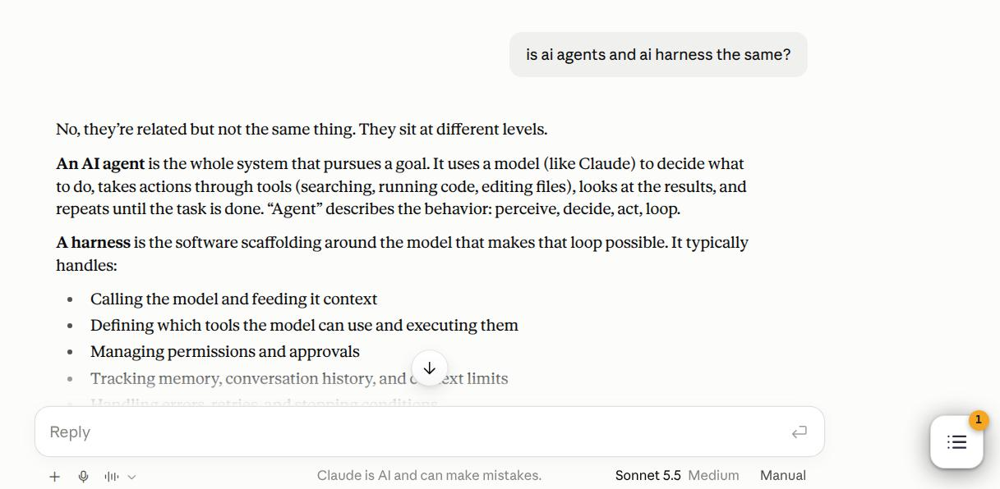
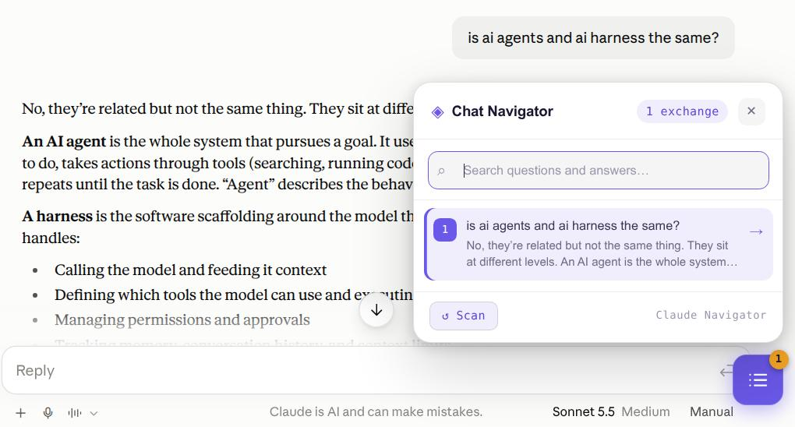

# Claude Chat Navigator — Chrome Extension

A panel on claude.ai conversation pages that lists every **Exchange** (your question plus Claude's answer) and jumps to it on click. Terms are defined in [GLOSSARY.md](./GLOSSARY.md).

## Screenshots

The toggle button sits at the bottom-right of a conversation, with a badge showing how many exchanges it found:

Open the panel to see each exchange with a preview of the answer, search across questions and answers, and jump to one:

## Installation

1. Open Chrome and go to `chrome://extensions`
2. Enable **Developer mode** (top-right)
3. Click **Load unpacked** and select this folder
4. Reload any open claude.ai tab

After pulling changes, click the reload icon on the extension card and reload the tab.

## Usage

| Action | How |
|---|---|
| Open/close the panel | **☰ button** (bottom-right), the toolbar icon, or **Alt+N** |
| Jump to an exchange | Click an item, or ↑/↓ + **Enter** inside the panel |
| Previous / next exchange | **Alt+↑** / **Alt+↓** (panel can stay closed) |
| Search | Type in the box; it matches the full question and answer text |
| Re-scan | **↺ Scan** in the panel footer |
| Resize | Drag the panel's left edge |

The panel only appears on conversation pages (`/chat/<id>`, including conversations inside Projects).

## Behaviour

- **Items** show the question's first line or sentence (about 80 characters) and a muted preview of Claude's answer.
- **Jump** aligns the question to the top of the view so the answer starts right below it.
- **Current exchange** is highlighted in the panel as you scroll.
- **Scan:** claude.ai removes off-screen messages from the page, so on first open the extension scrolls through the whole chat once to collect everything. Items appear as they are found, and your scroll position is restored afterwards. New messages are appended automatically. Editing a question or switching branches triggers a re-scan. Only the branch currently displayed is listed.
- **Theme** follows claude.ai's light/dark mode.
- **Privacy:** conversation text stays in memory. Only the panel's open/closed state and width are saved (in `localStorage`).

## Troubleshooting

**"No questions found"**
The conversation may still be loading: press **↺ Scan**. If it persists, claude.ai's layout probably changed. Click **Copy debug report** in the panel and use it to update the selectors at the top of `content.js`. You can also run `window.__ccnDebug()` in the DevTools console.

**Alt shortcuts do nothing**
Another extension or claude.ai may be using the same keys. The handlers are at the bottom of `content.js`.

## Files

| File | Purpose |
|---|---|
| `content.js` | Scan, panel, jump, keyboard, scroll-spy |
| `styles.css` | Panel styling, light/dark tokens |
| `background.js` | Toolbar icon → toggles the panel |
| `debug.js` | Page-world DOM inspector behind the debug report |
